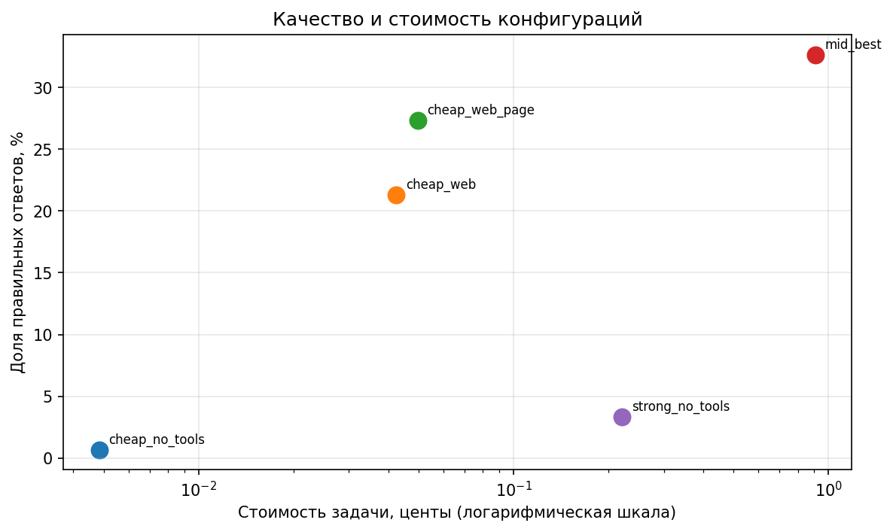

# ReAct-агент для вопросов о событиях 2026 года

В этой работе я проверила, помогает ли поиск по Википедии недорогой модели отвечать на свежие вопросы и оказывается ли такой агент выгоднее сильной модели без инструментов.

Домашнее задание выполнено в файле `ai-agent-homework.ipynb`. Сначала в ноутбуке идут материалы семинара, затем раздел `Homework` с реализацией агента, экспериментами и результатами.

## Датасет и проверка свежести

В [`data/fresh.jsonl`](data/fresh.jsonl) - 150 вопросов: 125 из набора семинара и 25 добавленных мной. Вопросы относятся к событиям после 1 января 2025 года, преимущественно к 2026 году. Исходные факты взяты из обзорных статей Википедии. Для своих вопросов я также использовала другие открытые источники, включая официальные публикации технологических компаний. Я составляла вопросы по уже произошедшим событиям с коротким ответом. Для каждого вопроса сохранены `question`, `answer`, `url` и `evidence` - цитата с ответом.

Проверка проведена скриптом семинара:

```bash
python check_fresh.py data/fresh.jsonl --sonnet
```

| Проверка | Результат |
|---|---:|
| Вопросов | 150 |
| Ошибок формата и совпадения ответа с цитатой | 0 |
| Sonnet 4.6 без инструментов | 3/150 (2%) |
| Допустимый порог | 20% |

Полный вывод: [`sonnet_check.txt`](sonnet_check.txt). Критерий свежести выполнен.

## Агент и замер

В [`ai-agent-homework.ipynb`](ai-agent-homework.ipynb) я добавила `page_find` для поиска по полному тексту статьи и оставила инструменты семинара: `web_search`, `calculator`, `python_exec`. У каждого инструмента есть Pydantic-схема и три теста (нормальный случай, пустой результат, ошибка). Агент ограничен числом шагов, проверяет повторные вызовы и сохраняет JSON-трассировки в [`traces/`](traces/). Запросы и расходы учитываются через `Ledger`.

На всех 150 вопросах я проверила пять обязательных конфигураций. Без инструментов - один вызов на вопрос, с инструментами - не более пяти шагов.

| Конфигурация | Модель и инструменты | Верно | $/вопрос | $/верный | Шагов в среднем | Время, с |
|---|---|---:|---:|---:|---:|---:|
| `strong_no_tools` | Sonnet 4.6, без инструментов | 3,33% | 0,002215 | 0,066440 | 1,00 | 3,64 |
| `cheap_no_tools` | GPT-4o-mini, без инструментов | 0,67% | 0,000048 | 0,007264 | 1,00 | 2,32 |
| `cheap_web` | GPT-4o-mini, `web_search` | 21,33% | 0,000424 | 0,001988 | 3,85 | 13,03 |
| `cheap_web_page` | GPT-4o-mini, `web_search` + `page_find` | 27,33% | 0,000497 | **0,001820** | 4,15 | 13,29 |
| `mid_best` | Haiku 4.5, `web_search` + `page_find` | **32,67%** | 0,009100 | 0,027857 | 3,30 | 12,30 |

Полные результаты: [`benchmark_results.csv`](reports/benchmark_results.csv) и [`final_report.csv`](reports/final_report.csv).



Ответ засчитывается, если нормализованный эталон содержится в ответе модели. В `normalize()` я дополнительно добавила перевод русских названий месяцев в английские: некоторые ответы содержали русские даты при английском эталоне. Проверка остаётся текстовой, поэтому смысловые эквиваленты вроде `22 March` и `March 22, 2026` могут оцениваться по-разному.

## Два провала агента

- **[`fresh-2`](traces/cheap_web_page/fresh-2.json):** вместо *Miguel Díaz-Canel* агент ответил *Iran and the United States*. Поиск нашёл материалы о другом событии; `page_find` прочитал нерелевантную статью и не помог исправить ответ.
- **[`fresh-3`](traces/cheap_web_page/fresh-3.json):** вместо *a strategic partnership agreement* агент ответил «Нет данных». Поиск не нашёл нужный факт, а `page_find` не был вызван.

## Вывод

На моём наборе тезис курса подтвердился: `cheap_web_page` точнее Sonnet без инструментов (27,33% против 3,33%) и заметно дешевле по стоимости правильного ответа ($0,001820 против $0,066440). Haiku 4.5 с инструментами дала максимальную точность (32,67%), но правильный ответ у неё стоил примерно в 15 раз дороже, чем у `cheap_web_page`. При этом даже лучший результат далёк от 100%: поиск пока-что ограничен Википедией, а агент иногда выбирает не ту статью или не использует нужный инструмент.

## Запуск

Нужны Python, зависимости из `requirements.txt` и API-ключ OpenRouter.

```bash
python -m venv .venv
source .venv/Scripts/activate  # Git Bash на Windows
pip install -r requirements.txt
cp .env.example .env
jupyter notebook ai-agent-homework.ipynb
```

В `.env` нужно указать `OPENROUTER_API_KEY`. На Linux/macOS окружение активируется через `source .venv/bin/activate`. Формат датасета можно проверить без вызова модели командой `python check_fresh.py data/fresh.jsonl`. Готовые результаты уже лежат в `reports/` и `traces/`. Запуск отсутствующих трассировок потребует платных запросов к OpenRouter. 
